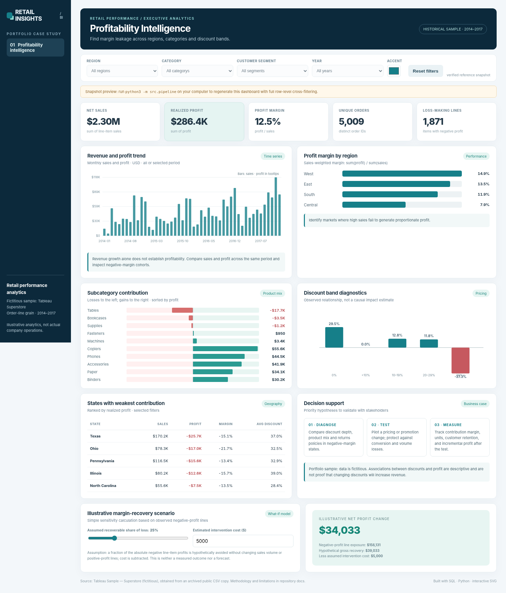

# Retail Profitability Intelligence

**Portfolio case study** · SQL (SQLite) · Python · Tableau · Excel · interactive HTML/SVG

This project investigates why a fictitious retail business can generate substantial sales while underperforming on profit. It examines **regional margins, product/subcategory contribution, discount-band associations and state-level loss concentrations**, then frames recommendations as testable business hypotheses rather than guaranteed financial outcomes.



## Explore the deliverables

| Deliverable | Location | What to expect |
|---|---|---|
| Interactive dashboard preview | [`dashboards/retail_profitability_preview.html`](dashboards/retail_profitability_preview.html) | Offline, independently authored SVG/CSS dashboard using verified summary statistics; scenario inputs work; full cross-filtering is disabled until the pipeline is run |
| Excel executive workbook | [`dashboards/retail_profitability_workbook.xlsx`](dashboards/retail_profitability_workbook.xlsx) | Formula-backed KPIs, regional/state/subcategory views, monthly trend, and recovery sensitivity model |
| Python ingestion / validation | [`src/pipeline.py`](src/pipeline.py) | Source retrieval, data quality checks, normalized CSV, SQLite analytic mart, complete HTML dashboard and 9 Tableau aggregates |
| Tableau build guide | [`tableau/TABLEAU_BUILD_GUIDE.md`](tableau/TABLEAU_BUILD_GUIDE.md) | Short list of exact worksheets and Tableau calculated fields to create the native workbook |
| SQL | [`sql/`](sql/) | Schema, reusable SQL views, business-question queries |
| Tests | [`tests/`](tests/) | Input validation, weighted margin calculations, reference checks |

The **preview dashboard** is a shipped, usable summary of the independently verified Superstore data. After running the pipeline on the complete source CSV, use **`dashboards/retail_profitability_dashboard.html`** for the full version with working Region, Category, Customer Segment and Year cross-filters.

## Verified baseline (archived 2014–2017 sample)

| Metric | Value |
|---|---:|
| Sales | **$2,297,200.86** |
| Realized profit | **$286,397.02** |
| Sales-weighted profit margin | **12.47%** |
| Unique orders | **5,009** |
| Order lines | **9,994** |
| Distinct customers | **793** |
| Order lines with negative profit | **1,871** |

### Selected business findings

1. The **Central region** had $501,239.89 in sales and $39,706.36 in profit (**7.92% margin**), compared with the West at **14.94% margin**. Regional differences warrant discount and product-mix investigation, not an automatic pricing conclusion.
2. The **Tables** subcategory contributed $206,965.53 in sales but **–$17,725.48** in profit. Bookcases and Supplies were also net negative over the full historical sample.
3. **Texas** was the weakest state in aggregate realized profit (–$25,729.36) despite $170,188.05 in sales. Its average **line-level** discount was approximately 37%.
4. The **30%+ discount band** was associated with negative realized profit, but this **does not prove** discounting caused the losses. Product selection, returns and purchasing behavior may confound the comparison.

The scenario model uses the observed absolute negative-profit line amounts and user-specified assumptions to illustrate *potential margin recovery*. It is not a profit forecast or experiment result.

## Run the complete project

Requires **Python 3.10+**. The pipeline itself uses **only Python's standard library**.

```bash
cd retail-profitability-intelligence
python3 -m src.pipeline
python3 -m unittest discover -s tests -v
open dashboards/retail_profitability_dashboard.html  # macOS
```

The first command downloads a public copy of the Tableau Superstore CSV, validates its schema and baseline totals, creates the analytics database, exports clean data for Tableau and generates the offline full dashboard. The original 2.2MB CSV is **not committed** to this repository; you can supply it manually if retrieval fails:

```bash
python3 -m src.pipeline --source ~/Downloads/Sample_Superstore.csv
```

To query the SQLite analysis locally:

```bash
python3 - <<'PY'
import sqlite3
with sqlite3.connect('data/processed/retail_profitability.db') as con:
    for row in con.execute('SELECT * FROM v_regional_profitability ORDER BY profit_margin_pct'):
        print(row)
PY
```

You can also connect Tableau directly to `data/processed/retail_clean.csv` after running the pipeline. The `tableau/` folder additionally contains nine ready-to-use grouped extracts (generated by the pipeline).

**Workbook note:** The included Excel dashboard is a verified **reference snapshot**. Running the pipeline regenerates its source-level CSV extracts, database and HTML dashboard; it does not silently overwrite the packaged Excel workbook.

## Analysis design

| Layer | Implementation |
|---|---|
| Source | Archived Tableau Sample — Superstore, Jan 2014–Dec 2017 |
| Data grain | One CSV row per **order line**, not per order/customer |
| Quality | Required field checks, unique row IDs, numeric bounds, ship-date validation, row/order/customer totals and monetary reconciliation |
| Transformation | Standardized names, ISO dates, profit/discount bands, category and regional aggregation |
| Storage | SQLite table `sales_lines` + 3 analytical views |
| Insights | Sales-weighted margins; realized profit and losses; discount association; product and geography prioritization |
| Delivery | HTML dashboard, Excel workbook, Tableau-ready source and aggregated CSVs |

## Folder structure

```text
retail-profitability-intelligence/
├── dashboards/
│   ├── retail_profitability_preview.html    # Works offline with verified aggregate snapshot
│   ├── dashboard_template.html             # Fully interactive row-level HTML template
│   ├── preview_screenshot.png
│   └── retail_profitability_workbook.xlsx
├── data/
│   ├── raw/                                 # Original CSV downloaded on first pipeline run
│   └── processed/reference_snapshot.json
├── src/
│   ├── pipeline.py                         # End-to-end reproducible data and dashboard pipeline
│   ├── reference_data.py
│   └── build_excel.py                      # Optional authoring utility; needs artifact_tool
├── sql/
│   ├── 01_schema.sql
│   ├── 02_analysis_views.sql
│   └── 03_business_questions.sql
├── tableau/TABLEAU_BUILD_GUIDE.md
├── docs/
│   ├── BUSINESS_CASE.md
│   ├── DATA_DICTIONARY.md
│   └── VALIDATION.md
└── tests/test_pipeline.py
```

## Limitations and sourcing

- Tableau **Superstore is fictitious**. Do not imply actual sales performance, actual client work, or measured profit improvements.
- **Profit margin** is `SUM(Profit) / SUM(Sales)`. Do not take an arithmetic average of line margins. **Order count** is distinct `Order ID`.
- Discount percentage is a mean across order lines unless otherwise specified (not sales-weighted).
- The dataset lacks purchase cost drivers, experiment assignment, customer response and true impact measurement. The project uses descriptive analysis only.
- Tableau officially documents Superstore as a sample dataset: [Tableau sample data](https://public.tableau.com/app/resources/sample-data) and [Tableau help](https://help.tableau.com/current/pro/desktop/en-us/find_good_datasets.htm).
- For reproducibility, the downloader retrieves the CSV from [this public Superstore data copy](https://github.com/mohamednsafi/superstore-sales-analysis/blob/main/data/raw/Sample_Superstore.csv). Only data are referenced; this project's code and dashboard design were independently implemented.

## Resume description (verify your familiarity before use)

**Retail Profitability & Discount Analytics | SQL, Python, Tableau, Excel** — Developed a retail analytics case study using 9,994 Superstore order lines, built SQL-based regional/product margin analyses and dashboard-ready extracts, and created an interactive dashboard highlighting low-margin markets and discount-associated losses. Designed an assumption-based profit-recovery scenario to support business decision-making.
